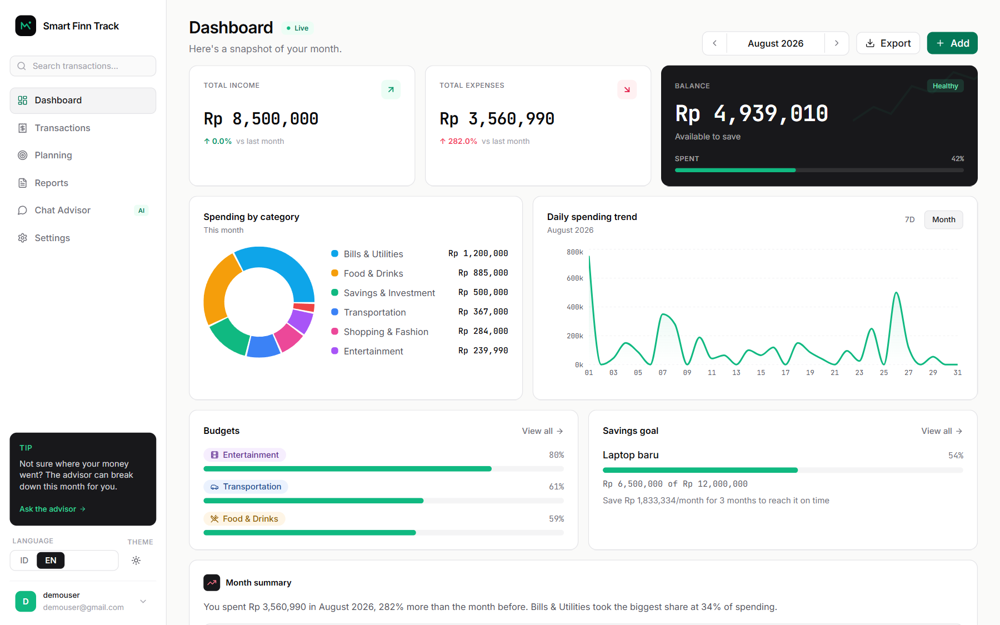
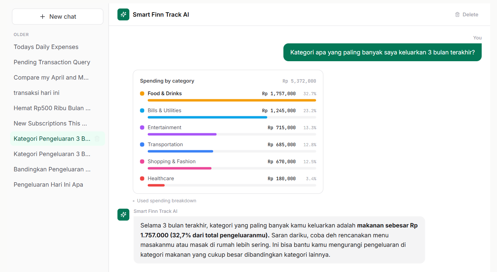
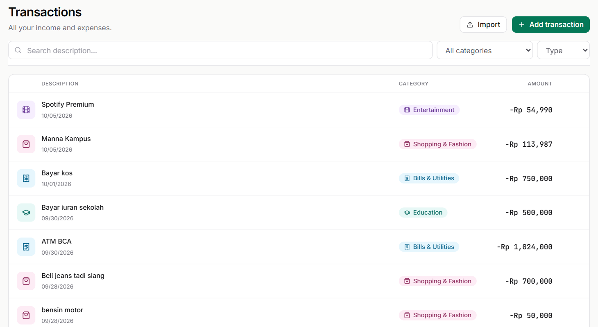
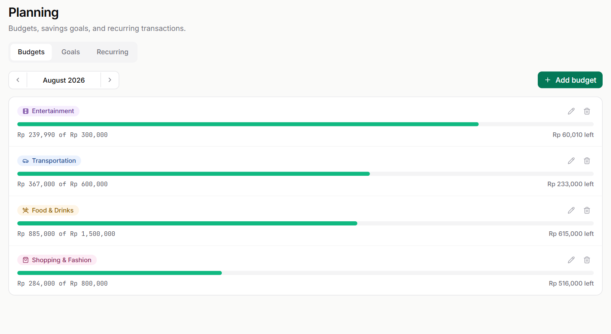

<!-- Generated by scripts/render_readme.py. Edit the generator, not this snapshot. -->

<h3>filan214@github:~$ git contributions --calendar</h3>

 

<h3 align="left">Recent repositories</h3>

 

 

 

<a href="https://github.com/filan214?tab=repositories">See all repositories</a>

 

<h3>filan214@github:~$ contact --reach</h3>

Got a project, a role, or a data question? Pick a channel.

 

 

<h3>filan214@github:~$ showcase --data-science · Jogja House Valuation</h3>

<table width="860"><tr><td width="50%" align="center" valign="top"> <b>Value a house</b> Estimate, likely range, verdict, and the reasons</td><td width="50%" align="center" valign="top"> <b>Market map</b> Median price per land m² by kecamatan</td></tr></table>

<a href="https://github.com/filan214/Jogja-House-Valuation">↗ Explore project</a> &nbsp; · &nbsp; <a href="https://github.com/filan214/Jogja-House-Valuation#how-to-run-locally">↗ Run it locally</a> &nbsp; · &nbsp; <a href="https://github.com/filan214/Jogja-House-Valuation/blob/a09da84c02976d77aca1a93094dc8d0b978bd1ce/reports/metrics.md">↗ Read model metrics</a>

Public Kaggle data by Pramudya Dika (CC BY-NC 4.0), scraped from Rumah123 in 2024 · asking prices, not sale prices · app runs locally, not deployed

 

<h3>filan214@github:~$ showcase --data-science · Customer Propensity &amp; Targeting</h3>

See the call list in Tableau

 

<a href="https://public.tableau.com/app/profile/valentinus.gunawan/viz/DealershipCross-SellPropensityDashboard/Dashboard1">↗ Open Tableau dashboard</a> &nbsp; · &nbsp; <a href="https://github.com/filan214/dealership-crosssell-propensity">↗ Explore project</a> &nbsp; · &nbsp; <a href="https://github.com/filan214/dealership-crosssell-propensity/blob/358d87e60c8110bbbf5d0cd3f7a45ebd27a5482d/notebooks/01_model.ipynb">↗ Inspect model notebook</a>

Public Kaggle data reframed as a dealership case, not client data

Inspect source evidence

 

 

<h3>filan214@github:~$ showcase --finance · AI for everyday money</h3>

<a href="https://ai-finance-tracker-delta-drab.vercel.app/"><picture><source media="(prefers-color-scheme: dark)" srcset="./screens/finance-dashboard-dark.png"></picture></a>

<table width="860"><tr><td width="33%" align="center" valign="top"><a href="https://github.com/filan214/filan214/blob/main/screens/finance-chat-light.png"><picture><source media="(prefers-color-scheme: dark)" srcset="./screens/finance-chat-dark.png"></picture></a> <b>AI advisor</b> Answers from your own rows, chart included</td><td width="33%" align="center" valign="top"><a href="https://github.com/filan214/filan214/blob/main/screens/finance-transactions-light.png"><picture><source media="(prefers-color-scheme: dark)" srcset="./screens/finance-transactions-dark.png"></picture></a> <b>Transactions</b> Auto-categorized history with search and filters</td><td width="33%" align="center" valign="top"><a href="https://github.com/filan214/filan214/blob/main/screens/finance-planning-light.png"><picture><source media="(prefers-color-scheme: dark)" srcset="./screens/finance-planning-dark.png"></picture></a> <b>Planning</b> Monthly budgets with live progress</td></tr></table>

Screens from the live demo's sample account · captured 06 Oct 2026

<strong>Smart Finn Track</strong> brings an AI advisor, spending insights, and monthly reports into a personal finance app. Try the live demo in one click, then follow the code behind it.

<a href="https://ai-finance-tracker-delta-drab.vercel.app/">↗ Open app</a> &nbsp; · &nbsp; <a href="https://github.com/filan214/AIFinanceTracker">↗ Explore AIFinanceTracker</a> &nbsp; · &nbsp; <a href="https://github.com/filan214/AIFinanceTracker/commit/370149aaaf24c72afe9142e6f0021b1e74a47c78">↗ Latest source commit</a>

Inspect source evidence

 

 

<h3>filan214@github:~$ ps --repos</h3>

<table width="860"><tr><th width="27%" align="left">Repository</th><th width="15%" align="left">Code</th><th width="25%" align="left">Commits · 28d</th><th width="19%" align="left">Last push (UTC)</th><th width="14%" align="left">Explore</th></tr>

<tr><td><a href="https://github.com/filan214/Jogja-House-Valuation">Jogja-House-Valuation</a></td><td>Python</td><td></td><td>2026-11-10</td><td><a href="https://github.com/filan214/Jogja-House-Valuation/commit/a09da84c02976d77aca1a93094dc8d0b978bd1ce">Commit</a></td></tr>

<tr><td><a href="https://github.com/filan214/ai_scout_football">ai_scout_football</a></td><td>Python</td><td></td><td>2026-11-10</td><td><a href="https://github.com/filan214/ai_scout_football/commit/4ee96238ca76f33cdd888bf1f3611780757826c9">Commit</a></td></tr>

<tr><td><a href="https://github.com/filan214/smartphone-dss-notebooks">smartphone-dss-notebooks</a></td><td>Jupyter Notebook</td><td></td><td>2026-11-06</td><td><a href="https://github.com/filan214/smartphone-dss-notebooks/commit/d661ad0cad2e27ddd9e583b722abbd899280ba72">Commit</a></td></tr>

<tr><td><a href="https://github.com/filan214/AIFinanceTracker">AIFinanceTracker</a></td><td>TypeScript</td><td></td><td>2026-11-05</td><td><a href="https://github.com/filan214/AIFinanceTracker/commit/370149aaaf24c72afe9142e6f0021b1e74a47c78">Commit</a> · <a href="https://ai-finance-tracker-delta-drab.vercel.app">Site</a></td></tr>

</table>

28-day default-branch activity · all authors · each line scaled to its own peak

 

Read all 10 pushes &amp; open commits

 

<table width="860"><tr><th align="left" width="20%">Pushed (UTC)</th><th align="left" width="25%">Repository / branch</th><th align="left" width="55%">Head commit</th></tr>

<tr><td>2026-11-10 15:24:55</td><td><a href="https://github.com/filan214/Jogja-House-Valuation">filan214/Jogja-House-Valuation</a> master</td><td><a href="https://github.com/filan214/Jogja-House-Valuation/commit/ce9c4df3553f5d40c4706c02b010faa063d37e03">ce9c4df</a> add readme</td></tr>

<tr><td>2026-11-10 15:15:12</td><td><a href="https://github.com/filan214/ai_scout_football">filan214/ai_scout_football</a> main</td><td><a href="https://github.com/filan214/ai_scout_football/commit/4ee96238ca76f33cdd888bf1f3611780757826c9">4ee9623</a> Add live league table and suggested ambition</td></tr>

<tr><td>2026-11-10 12:19:28</td><td><a href="https://github.com/filan214/ai_scout_football">filan214/ai_scout_football</a> main</td><td><a href="https://github.com/filan214/ai_scout_football/commit/08068cc5831c568583033276b36f7bceccbc08e2">08068cc</a> Add weekly live squads, clubs and market values from FotMob</td></tr>

<tr><td>2026-11-10 10:05:57</td><td><a href="https://github.com/filan214/ai_scout_football">filan214/ai_scout_football</a> main</td><td><a href="https://github.com/filan214/ai_scout_football/commit/d356e0604e5340712e3be127421603ce16d7bf9c">d356e06</a> Add weekly Transfermarkt snapshot freshness check</td></tr>

<tr><td>2026-11-05 16:39:39</td><td><a href="https://github.com/filan214/AIFinanceTracker">filan214/AIFinanceTracker</a> main</td><td><a href="https://github.com/filan214/AIFinanceTracker/commit/370149aaaf24c72afe9142e6f0021b1e74a47c78">370149a</a> chore: stop tracking internal working files (kept locally, now gitignored)</td></tr>

<tr><td>2026-11-05 15:48:18</td><td><a href="https://github.com/filan214/AIFinanceTracker">filan214/AIFinanceTracker</a> main</td><td><a href="https://github.com/filan214/AIFinanceTracker/commit/1319d97cbca2756cf7ef9c492e4c904dd5273f5f">1319d97</a> chore: stop tracking docs/superpowers (kept locally, now gitignored)</td></tr>

<tr><td>2026-11-05 15:25:13</td><td><a href="https://github.com/filan214/AIFinanceTracker">filan214/AIFinanceTracker</a> main</td><td><a href="https://github.com/filan214/AIFinanceTracker/commit/c83241d43df19e32075cc774f248c29fb3e4cc2d">c83241d</a> docs: handoff + progress for chat formatting, focus ring and register fixes</td></tr>

<tr><td>2026-11-03 10:07:47</td><td><a href="https://github.com/filan214/F1-tyre-degradation">filan214/F1-tyre-degradation</a> main</td><td><a href="https://github.com/filan214/F1-tyre-degradation/commit/3dd79e8c5a058cc3ee6ae2832c7543fc8c9d9d69">3dd79e8</a> done added</td></tr>

<tr><td>2026-10-24 07:05:47</td><td><a href="https://github.com/filan214/dealership-crosssell-propensity">filan214/dealership-crosssell-propensity</a> main</td><td><a href="https://github.com/filan214/dealership-crosssell-propensity/commit/358d87e60c8110bbbf5d0cd3f7a45ebd27a5482d">358d87e</a> update 2</td></tr>

<tr><td>2026-10-20 15:28:24</td><td><a href="https://github.com/filan214/FormWAtch-Football">filan214/FormWAtch-Football</a> master</td><td><a href="https://github.com/filan214/FormWAtch-Football/commit/9d1e8f14fbd1ee3ca18f3eff740295b9bff97177">9d1e8f1</a> Remove PRD documents from the repository</td></tr>

</table>

Public push events by filan214 across repositories and branches. GitHub exposes a limited event window and may delay events; fewer than ten results are shown when that is all it supplies. Profile automation and configured exclusions are omitted.

Push feed synced: 13 Nov 2026 · 07:22 WIB · <a href="https://github.com/filan214/filan214/blob/main/data/commit-stream.json">Inspect source snapshot</a>

 

<h3>filan214@github:~$ languages --bytes</h3>

 

 

<h3>filan214@github:~$ sources --inspect · Data sources &amp; freshness</h3>

Refreshed hourly at minute 17 · also on profile pushes and manual runs

Inspect sources, measurement scope &amp; refresh behavior

 

<table width="860"><tr><th align="left">Snapshot</th><th align="left">What it measures</th></tr>

<tr><td><a href="https://github.com/filan214/filan214/blob/main/data/builds.json">Projects &amp; activity</a></td><td>Public repository metadata, most recently pushed repositories, and 28-day default-branch commit history, all authors. Synced 13 Nov 2026 · 07:21 WIB.</td></tr>

<tr><td><a href="https://github.com/filan214/filan214/blob/main/data/commit-stream.json">Cross-repo pushes</a></td><td>Available public push events by filan214; one exact head commit per push. Synced 13 Nov 2026 · 07:22 WIB.</td></tr>

<tr><td><a href="https://github.com/filan214/filan214/blob/main/data/highlights.json">Project spotlights</a></td><td>File inventories pinned to the displayed source commit, valuation and cross-sell results quoted from each project&#x27;s README at the same commit, 90-day commit history, latest public workflow observation, and a public finance landing-page check.</td></tr>

<tr><td><a href="https://github.com/filan214/filan214/blob/main/data/contributions.json">Contribution calendar</a></td><td>GitHub contribution HTML: full account totals, including automation.</td></tr>

<tr><td><a href="https://github.com/filan214/filan214/blob/main/data/languages.json">Language mix</a></td><td>GitHub Linguist byte counts from eligible public repositories. Code proportions, not proficiency.</td></tr>

<tr><td><a href="https://github.com/filan214/filan214/blob/main/screens/manifest.json">Finance screenshots</a></td><td>Static captures of the public demo account (August 2026 data), taken 06 Oct 2026 by scripts/capture_finance_screens.js. Not refreshed hourly.</td></tr>

</table>

Project selection and aggregate languages exclude this profile repository, configured exclusions, forks, and archives. The three curated spotlights follow Jogja-House-Valuation, dealership-crosssell-propensity and AIFinanceTracker while they remain public and active.

Source counts show files and registered tools, not passed tests or feature-health checks. Workflow results identify their commit. The cross-sell card shows source structure and commit history; its model results are quoted from the project README, not recomputed here, and the valuation story quotes its figures the same way. The finance app check only tests its public landing page, without accessing an account or financial data.

GitHub schedules, event delivery, source analysis, and image caches can delay updates. A failed refresh keeps the last published snapshot and its recorded timestamps. The portrait is supplied by Filan.

<a href="https://github.com/filan214/filan214/actions/workflows/update-profile-art.yml">↗ Refresh workflow</a> &nbsp; · &nbsp; <a href="https://github.com/filan214/filan214/tree/main/scripts">↗ Explore the generators</a>

